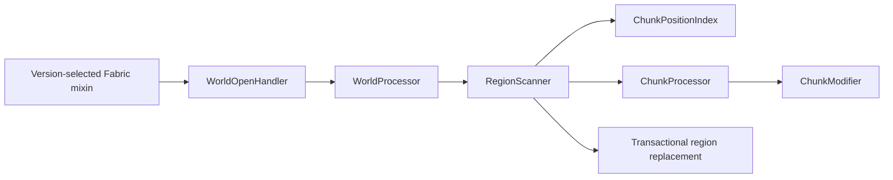

# Architecture

## Design goals

ForceBlend keeps the risky world-data work in one small, testable core. Version-specific code is limited to selecting
the correct moment to run and the correct blending marker format.

## Compatibility shell

`ForceBlendMixinPlugin` reads the stable Minecraft version before targets are resolved and enables exactly one adapter:

| Version        | Target namespace    | Entry point                |
|----------------|---------------------|----------------------------|
| 1.18-1.18.2    | Fabric intermediary | `class_310.method_29606`   |
| 1.19-1.20.2    | Fabric intermediary | `class_7196.method_41894`  |
| 1.20.3-1.20.4  | Fabric intermediary | `class_7196.method_54618`  |
| 1.20.5-1.21.11 | Fabric intermediary | `class_7196.method_57784`  |
| 26.1-26.2      | Mojang official     | `WorldOpenFlows.openWorld` |

The adapters capture only the world directory name. They contain no Minecraft parameter or return types, which prevents
verifier failures when a class signature changes in another supported version.

`WorldOpenHandler` resolves `<game>/saves/<level>`, chooses the modern nested Overworld path when it contains region
data, and otherwise uses the legacy world root. It also resolves the running release family to an explicit blending
profile before the core can process a chunk. Every open enters `WorldProcessor`; there is deliberately no seed-identity
or prior-run gate.

## Loader-neutral processing core

The main source set imports no `net.minecraft` classes. It uses:

- Java NIO and random-access I/O for Anvil region files;
- Querz/NBT for the binary NBT model;
- the `lz4-pure-java` artifact's safe implementation for compression type 4;
- standard Java GZIP, ZLIB, and uncompressed streams.

`ChunkStatusPolicy` deliberately accepts only the normalized `minecraft:full` status. Minecraft's native migration data
fix can use some later protochunk stages, but forced same-version migration does not need to mark unfinished terrain.
`ChunkModifier` is the only production class allowed to mutate chunk NBT: it removes a previously written unsafe marker
from a partial chunk, or writes `old_noise: 1b` for Minecraft 1.18-1.18.2 and a derived section range for Minecraft
1.19+. Height/light caches are invalidated only while preparing a complete chunk. There is intentionally no
format-agnostic default profile.

## Topology planning and region transaction

The first read-only phase validates and classifies every stored chunk. Complete `full` terrain positions are stored in
`ChunkPositionIndex`, which uses a 1,024-bit `BitSet` per populated Anvil region instead of one heap object per chunk.
Partial chunks with unsafe markers are collected in a separate compact index.

The complete-terrain index selects chunks that have at least one non-complete position within an inclusive seven-chunk
square. This is the maximum source offset used by Minecraft 1.18.2's native Blender and conservatively covers the
bounded modern query. The rule naturally finds outer borders, disconnected imported islands, and internal deletion
cavities. Deep-interior complete chunks are excluded.

Each source region then receives a targeted read-only inspection. Unselected chunks are counted directly from the
validated header and are not decompressed again. If no target needs mutation, ForceBlend returns the report without
creating or writing a temporary region. When the first required change is found, the source is read again while a
compact replacement is assembled in the same directory. Unselected streams are copied without NBT decoding. No
source-sector mutation occurs during this phase. After every discovered chunk succeeds, changed external streams are
promoted and the temporary region atomically replaces the original when the filesystem supports atomic moves. If
processing fails, temporary files are deleted and the source region remains in place.

Unchanged regions are never rewritten or replaced. A second pass therefore avoids temporary region I/O and preserves
their bytes exactly.

## Continuous detection

The topology is recomputed before every local world open. This is required because chunk imports and deletions change
`.mca` contents without necessarily changing `level.dat`, the seed, the Minecraft version, or any generator identity.
Existing correct markers remain binary-idempotent; newly imported frontier chunks are discovered immediately; legacy
beta.4 state/request files are ignored.

Continuous detection answers a spatial question instead of trying to guess a chunk's history: “Can Minecraft consult
this complete chunk while blending a currently missing or incomplete position nearby?” The result is bounded to the
native seven-chunk reach instead of marking an entire world.

## Dependency boundaries

- Fabric Loader and Mixin are permitted only in the client source set.
- Minecraft classes are forbidden in production source.
- NBT mutation is confined to `ChunkModifier`.
- Chunk-generation eligibility is confined to `ChunkStatusPolicy`.
- Dimension selection is confined to `WorldOpenHandler` and `WorldProcessor`.
- Spatial eligibility and compact topology storage are confined to `ChunkPositionIndex` and `RegionScanner`.
- Compression-specific code is confined to `RegionCompression`.
- Region layout, external chunk streams, and commit behavior are confined to `RegionScanner`.

Querz/NBT remains pinned to upstream release `6.1`. Fabric Loom reports that Maven version string as non-SemVer while
nesting the JAR; this is a build-time metadata warning from the upstream coordinate, not a runtime dependency or
compatibility failure. Replacing a proven NBT codec solely to hide that warning would add more world-data risk than
value.

## Adding a future version

1. Verify the version is stable and determine its Java baseline.
2. Audit the exact world-open method in official or Fabric intermediary mappings.
3. Confirm the Overworld storage path and Anvil compression behavior.
4. Audit the exact `blending_data` codec and the chunk-status eligibility boundary; add a strategy if either differs.
5. Extend the metadata range and mixin selector only after the above evidence exists.
6. Add a mapping audit record, automated fixture coverage, and an in-game smoke test.

Do not make the universal metadata open-ended. A future version must fail dependency resolution until its lifecycle and
data format have been reviewed.
