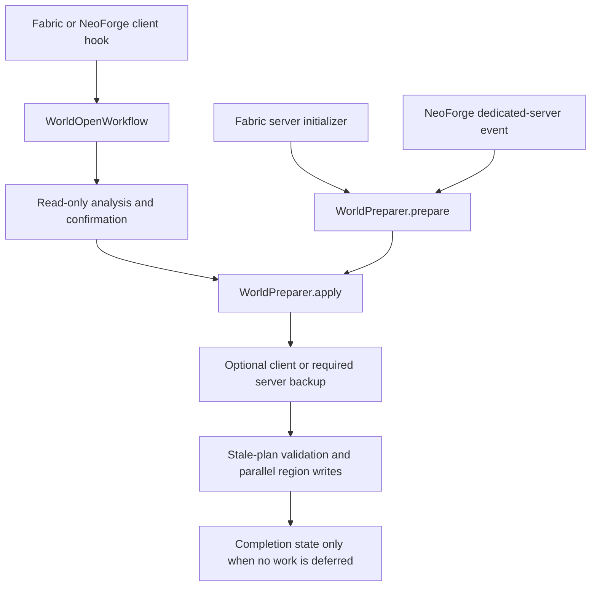

# Architecture

Original mod by Mauro0805. Maintained by Mauro0805 and SasnycoN.

## Shared preparation

`WorldPreparer` is the loader-neutral coordinator for analysis, backups, application, and completion state.
`WorldProcessor` and `RegionScanner` retain the existing Anvil/NBT behavior. Fabric and NeoForge produce separate JARs
from the same shared source files.

## Loader boundaries

Fabric selects one client adapter before resolving Minecraft targets:

| Minecraft | Target |
|---|---|
| 1.18-1.18.2 | `class_310.method_29606` |
| 1.19-1.20.2 | `class_7196.method_41894` |
| 1.20.3-1.20.4 | `class_7196.method_54618` |
| 1.20.5-1.21.11 | `class_7196.method_57784` |
| 26.1-26.3 | `WorldOpenFlows.openWorld(String, Runnable)` |

The 26.x hook captures arguments by descriptor and supports cancellation. It does not use local-variable names.
The Fabric client bridge resolves the save path, then calls the shared `WorldOpenWorkflow`.

The Fabric dedicated-server entrypoint reads `server.properties`, honors `--world` and `--universe`, and invokes the
headless coordinator before level loading. It contains no Minecraft method signatures.

NeoForge uses `ServerAboutToStartEvent` for dedicated servers. The event is not cancellable, so integrated worlds use
a client mixin before `WorldOpenFlows.openWorld`. This preserves Enter unchanged and Cancel without turning a user's
choice into a server startup exception. The server event skips integrated servers to avoid processing twice.

The shared screens, workflow, and configuration controller have no Fabric class references. The Fabric initializer,
mixin family, Mod Menu bridge, and server entrypoint live only in `fabric/src/`, not in the shared tree. Its client mixin is listed only
in the client section of its mixin configuration, keeping native client classes out of dedicated-server startup.

Client hooks cancel the original call while read-only analysis runs on a background coordinator. Native screens retain
the four choices. Applying runs backup and processing off the render thread; the client thread polls immutable progress
snapshots once per tick. Continuing replays the original call and its arguments with a scoped bypass, so it is not
intercepted a second time.

`NativeScreen` resolves the official or intermediary namespace and generates a small Screen subclass for `init`, `tick`,
and close callbacks. Widgets, rendering, focus, and input remain Minecraft's. This avoids linking one Fabric JAR to the
different rendering signatures across versions. It uses the ASM runtime supplied by the loader, not an extra bundled
library. Neither the workflow nor Mod Menu settings uses Swing or changes the global AWT headless flag.

## Configuration and completion

`ForceBlendConfigStore` persists `config/forceblend.properties` through a flushed temporary file and replacement.
The defaults are once per world, automatic analysis on, optional client backup off, detailed logs off, unlimited chunks,
and all processors reported by the JVM.

`WorldPreparationState` accepts the current `forceblend.json` and legacy `forceblendonce.json` markers. The legacy file
is recognized by presence because old releases emitted non-strict JSON. Unsafe marker paths are rejected.

In once mode, the marker is checked before analysis and written atomically only after a successful application with
existing terrain and zero deferred chunks. Failed backups, failed application, absent terrain, and limited unfinished
runs do not create the marker. Every-opening mode ignores completion markers.

## Read-only plans and parallel writes

Analysis validates region headers and chunk streams, builds the complete-terrain index, selects the seven-chunk
frontier, and applies deterministic limits in stable region/chunk order. It retains metadata, bitsets, and expected
outcomes in an immutable plan rather than retaining entire worlds of decoded NBT.

Analysis, stale-plan validation, and application run independent region tasks in bounded worker pools. One worker owns
each region. Results keep selection order regardless of task scheduling, and outstanding tasks finish or are cancelled
before control returns after a failure.

Before writes, the region set, source metadata, Anvil header digests, and external payload digests must still match.
Selected chunks are decoded again and must produce the predicted outcome. Confirmation does not require a second
complete NBT analysis.

`ChunkModifier` is the only class that mutates chunk NBT. New blending markers invalidate only derived height/light
caches. Unselected chunk payloads and timestamps are preserved. Changed regions use temporary assembly, forced writes,
source validation, and replacement.

Changed external `.mcc` files and their `.mca` region are snapshotted by hard link with a copy fallback. Ordinary move
failures restore the snapshots. This is a per-region safeguard: an earlier region is not rolled back when another
region fails. Power loss or concurrent external editors are outside that guarantee.

## Backups and progress

The coordinator completes backups before application. Dedicated servers require them regardless of the optional client
backup preference. `WorldBackupService` writes complete world ZIPs under `backups/forceblend/<world>/`, excludes the
runtime root `session.lock`, verifies the source manifest, and publishes a collision-safe timestamp only on success.
Partial archives are removed on ordinary failure.

Core progress snapshots contain phase, real region/chunk counts, active regions, and elapsed time. Client screens read
the latest snapshot without queuing every worker update. Headless runs log periodic progress, with per-region/per-chunk
events only when detailed logging is enabled.

The initial ETA is an estimate from current analysis work, not a benchmark or completion deadline. Backup time is shown
separately by file counts and an ETA based on copied bytes. Completion appears in game before world loading resumes.

## Future versions

Audit the exact lifecycle descriptor, Java requirement, storage paths, chunk-status policy, and blending codec before
extending either loader's declared range. Keep version-specific native types in the adapters. Test the exact artifact
in game before describing a version as verified.

The 26.3 integration was consulted against
[the ForceBlend Once source](https://github.com/valcheffnet/forceblend-once/tree/bc196dcf47ea0ae5283a04f2b65a8f52d4fdb13d).
The event boundary is visible in
[NeoForge's ServerAboutToStartEvent](https://github.com/neoforged/NeoForge/blob/26.3.x/src/main/java/net/neoforged/neoforge/event/server/ServerAboutToStartEvent.java).

## Source and build layout

`common/src/main/` contains the loader-neutral core and shared resources. `common/src/client/` contains the screen
bridge, workflow, and settings controller. Tests live in `common/src/test/` and run through the Fabric build.
`fabric/src/` and `neoforge/src/` contain their respective loader adapters and metadata.

The root Gradle composite build coordinates the independent loader builds. Both compile common sources directly
and read root version/library settings. `paper/` is planning only and is excluded from the build.
