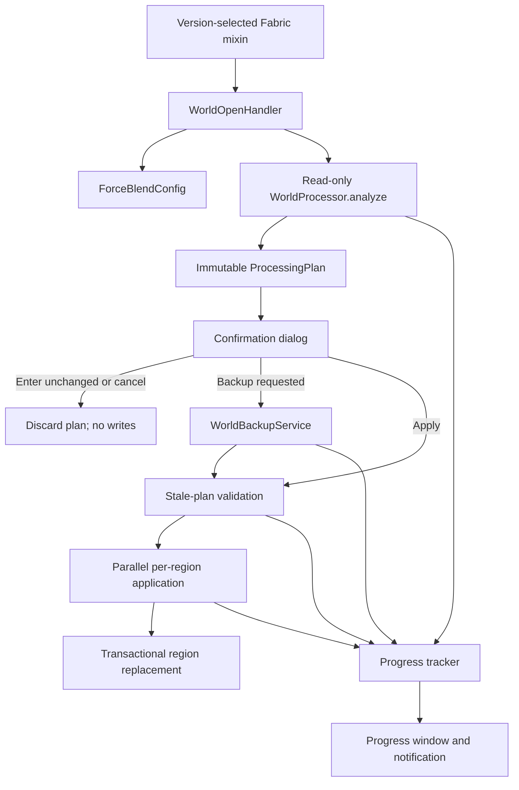

# Architecture

## Design goals

ForceBlend keeps Minecraft-version hooks small and keeps risky world-data work in a loader-neutral Java 17 core. The
1.1 workflow also enforces a simple rule: analysis and user choice happen before backup or modification.

## Compatibility shell

`ForceBlendMixinPlugin` reads the stable Minecraft version before targets are resolved and enables exactly one adapter:

| Version        | Target namespace    | Entry point                |
|----------------|---------------------|----------------------------|
| 1.18-1.18.2    | Fabric intermediary | `class_310.method_29606`   |
| 1.19-1.20.2    | Fabric intermediary | `class_7196.method_41894`  |
| 1.20.3-1.20.4  | Fabric intermediary | `class_7196.method_54618`  |
| 1.20.5-1.21.11 | Fabric intermediary | `class_7196.method_57784`  |
| 26.1-26.2      | Mojang official     | `WorldOpenFlows.openWorld` |

The adapters capture only the world directory name and ask `WorldOpenHandler` whether the intercepted open should
continue. They contain no Minecraft parameter or return types, which limits verifier failures when class signatures
change across the declared range.

The client workflow uses JDK desktop dialogs instead of Minecraft screen classes. This is deliberate: 1.18-1.21 uses
intermediary client names while 26.x exposes Mojang names, and one screen implementation could not safely link against
both. If the desktop UI is unavailable, the handler chooses the safe fallback and leaves the world unchanged.

Mod Menu support uses a reflective language adapter. Installing Mod Menu adds a settings entry; omitting it does not
remove any processing capability or introduce a missing-class dependency.

## Configuration boundary

`ForceBlendConfig` is an immutable loader-neutral record. `ForceBlendConfigStore` persists it as a small properties file
at `<game>/config/forceblend.properties`.

Missing files receive the documented defaults. Invalid individual values fall back to defaults with warnings. Saves
are written to a sibling temporary file, forced to disk, and atomically replace the old file where the filesystem
supports it. The previous file remains intact if replacement fails.

The defaults are automatic analysis on, automatic backup off, detailed logging off, unlimited chunks, and all
processors reported by the JVM. A numeric worker setting never deliberately oversubscribes the available processors.

## Read-only planning

`WorldProcessor.analyze` resolves only the selected Overworld `region` directory and delegates to `RegionScanner`. The
analysis phase:

1. lists region files in stable filename order;
2. reads and validates their headers and chunk streams in parallel;
3. classifies complete terrain, incomplete terrain, existing valid markers, and unsafe markers;
4. builds compact world topology with `ChunkPositionIndex`;
5. selects the seven-chunk frontier and repairs that are actually eligible;
6. applies the configured limit in deterministic region/chunk order;
7. captures region snapshots and returns an immutable `ProcessingPlan`.

No file is written in this phase. The plan carries the exact selected and deferred counts, affected regions, expected
chunk outcomes, work-size inputs, and analysis duration. The initial apply estimate is derived from work observed on the
current machine; the client uses a conservative fallback when the sample is insufficient. It is an estimate, not a
benchmark or deadline.

Keeping the plan in memory lets the confirmation dialog pause the workflow without forcing a second full analysis.

## Deterministic parallel execution

Analysis, validation, and application submit independent region tasks to a bounded worker pool. The default worker
count is every processor available to the JVM; users can choose a smaller number. A region appears at most once in each
task set, so two workers never write the same `.mca` file.

Selection and chunk-limit ordering happen before workers run. Results are joined and reduced after the tasks finish, so
thread scheduling does not decide which chunks are deferred. A failure cancels outstanding work and is surfaced to the
world-open handler.

Progress snapshots are immutable and include phase, total/completed regions, total/completed chunks, affected chunks,
active regions, and elapsed time. The UI derives rolling ETA and throughput from those snapshots and throttles visual
updates. Region and chunk event detail is generated only when detailed logging is enabled.

## Stale-plan validation

A user may spend time reading the confirmation dialog or creating a backup, so application cannot assume the analysis
is still current. Before any region worker writes, ForceBlend validates the complete planned region set and each
captured snapshot.

Snapshots cover file size and modification time, the validated Anvil header digest, and digests for external chunk
payloads. During application, selected chunks are decoded again and must still produce the outcome predicted by the
plan. A mismatch raises a stale-plan error and stops world opening instead of applying uncertain data.

## Region transactions

`ChunkModifier` remains the only production class allowed to mutate chunk NBT. It removes an unsafe legacy marker from
an incomplete chunk or writes `old_noise: 1b` for Minecraft 1.18-1.18.2 and a section range for Minecraft 1.19+.
Height/light caches are invalidated only while preparing a complete chunk.

Each selected source region is read while a compact replacement is assembled in a temporary sibling file. Unselected
streams are copied without NBT mutation. The replacement is forced to disk and the source snapshot is checked again
before staged external streams and the temporary region are moved into place. Temporary artifacts are cleaned on
ordinary failure. Regions with no selected change are never rewritten.

When a changed chunk uses an external `.mcc` stream, ForceBlend first snapshots the original sidecars and `.mca` by
hard link, with a copy fallback. If any sidecar or final region move fails, those snapshots are restored in reverse
order. Regions without changed sidecars keep the direct atomic-replacement path.

This remains a per-region transaction; it is not a single all-world transaction. Earlier successfully replaced regions
are not rolled back if a later region encounters an I/O failure, which is one reason backups and stale-plan validation
remain important.

## Complete world backups

`WorldBackupService` runs before application when requested. It writes a complete ZIP to a partial sibling under
`<game>/backups/forceblend/<world>/`, reports file/byte progress, forces the archive, and publishes it with a timestamp.
Name collisions receive numeric suffixes instead of overwriting an older backup.

The service rejects source/destination overlap, symbolic links in the source or destination ancestry, and unsafe ZIP
paths. It scans the world again before publication; if the source file set, sizes, or timestamps changed, the partial
archive is discarded. Cancellation and ordinary failure also remove the partial file.

## Dependency boundaries

- Fabric Loader, Mixin, lifecycle adapters, dialogs, and Mod Menu reflection live in the client source set.
- Minecraft classes are forbidden in the main processing, configuration, and backup source set.
- NBT mutation is confined to `ChunkModifier`.
- Chunk-generation eligibility is confined to `ChunkStatusPolicy`.
- Dimension selection is confined to `WorldOpenHandler` and `WorldProcessor`.
- Spatial eligibility and compact topology live in `ChunkPositionIndex` and `RegionScanner`.
- Compression behavior is confined to `RegionCompression`.
- Anvil layout, external streams, planning, stale validation, and region commit behavior live in the processing package.
- Backup path and ZIP safety live in `WorldBackupService`.
- Persistent user preferences live in the configuration package.

Querz/NBT remains pinned to upstream release `6.1`. Fabric Loom reports that Maven version string as non-SemVer while
nesting the JAR; this is an upstream metadata warning, not a runtime dependency or compatibility failure.

## Adding a future version

1. Verify the version is stable and determine its Java baseline.
2. Audit the exact world-open method in official or Fabric intermediary mappings.
3. Confirm the Overworld storage path and Anvil compression behavior.
4. Audit the exact `blending_data` codec and chunk-status eligibility boundary.
5. Verify that the shared desktop and optional Mod Menu boundaries still load.
6. Extend the metadata range only after mapping evidence, automated coverage, and an in-game smoke test exist.

Do not make universal metadata open-ended. A future Minecraft version should fail dependency resolution until its
lifecycle and data format have been reviewed.
